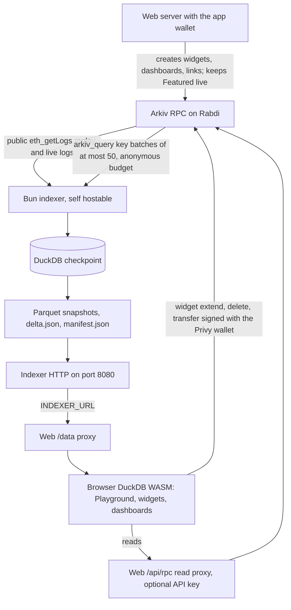

#  Arkiv SQL Indexer

Plain SQL over every live Arkiv entity. The project has two parts:

1. **An open source, self hostable indexer** (`apps/indexer`). It mirrors all Arkiv entities on chain, or a subset chosen with `INDEX_EXPRESSION`, into versioned Parquet snapshots plus a JSON delta and a manifest served over HTTP. Run it with Docker Compose or Bun. MIT licensed.
2. **A web app** (`apps/web`) that runs against the hosted indexer covering all Arkiv data on the Rabdi testnet. It offers a SQL Playground (DuckDB WASM in your browser), widgets (one SQL query plus a chart, saved as Arkiv entities) and public dashboards, including Featured dashboards kept live by the app.

**Who is stuck today.** Arkiv app teams, analysts and AI agents who need `GROUP BY`, `JOIN` or `ORDER BY` on attributes. `arkiv_query` returns at most 200 rows per page, newest first, with none of those. Answering "which wallets create the most entities?" means paging about 183 pages of 200 over the 36,457 live entities and counting in their own code. Anonymously that runs into a cost budget: on 18 October 2026 the `RateLimit` header of an anonymous `arkiv_query` reported `limit=10000` cost units with a reset after about one hour, and one broad query used all of it ([friction report](arkiv/friction.md#anonymous-query-budget-and-error-envelope)). That figure is our header reading, not a documented one; the Arkiv docs say only that the public RPC works "at the default rate limit". On 20 October 2026 the header reports `limit=600, reset=60` instead, which counts requests per 60 second window, with `Arkiv-Cost: 100` per query, so the caller can no longer see how much cost budget is left. At the 18 October budget that is about 100 queries an hour, an estimate from the cost header. The alternative today is to write their own indexer from `eth_getLogs`: decode the operation logs, track owners and expiry blocks, and fetch attributes by key on the same budget. **What changes on day one:** a documented data contract ([Data API](#data-api-for-apps-and-ai-agents), [arkiv/schema.md](arkiv/schema.md)), an MIT indexer anyone can run without an API key, and hosted Parquet files that DuckDB or Python read without asking anyone. That question becomes one `GROUP BY` that runs in milliseconds in the browser. **A day one consumer:** an analyst with the DuckDB CLI 1.5.5 and nothing else ran `./examples/top-creators.sh` against the hosted index on 20 October 2026 at 02:37 UTC and had the ten top creators of live entities in 3.0 seconds of wall clock time, including the HTTPS reads of the manifest and the Parquet snapshot (`real 2.99` from `/usr/bin/time -p`). No clone of the indexer, no API key and no RPC call were involved.

**Who is protected.** A viewer of a Featured dashboard, who trusts that its charts were published by this app, and a widget author, who trusts that their address stays on their widget. Anyone can create an entity with `project = arkiv-sql-indexer-dash`, `user = <app wallet>` and `login = arkiv`. An app that trusted attributes would show that look alike as Featured. Every read here filters on the chain set `$creator`, and Featured also requires `$owner`, so a forged entity never appears. See [Why this pillar](#why-this-pillar).

| | URL |
| :--- | :--- |
| Hosted app | https://arkiv-sql.dokploy.anshudhar.dev |
| Hosted indexer (all Rabdi entities) | https://arkiv-sql-indexer.dokploy.anshudhar.dev |
| Demo video | `<VIDEO_URL>` |
| On chain evidence (wallets, entities, transactions) | [On chain evidence](#on-chain-evidence) |
| Entity schema and exact queries | [arkiv/schema.md](arkiv/schema.md) |
| Arkiv friction report | [arkiv/friction.md](arkiv/friction.md) |

Built during Arkiv: Global Tour Stop on the Tiramisu testnet (chain ID 7738577) with `@arkiv-network/sdk` 0.8.1 and direct JSON RPC, within the challenge window of 9 October 2026 to the extended deadline of 20 October 2026. The git history runs from the first commit `9ae759d` (18 October 2026, an empty workspace scaffold with the spec and plans) to the last commit on 20 October 2026. Pre-existing work: none; no code predates the first commit. Tracks: Open Source and Security. Licensed under the [MIT License](LICENSE).

## Why this pillar

### Open Source: another team builds on the data without asking

**Who is stuck.** Teams building on Arkiv, analysts and AI agents who need aggregates over Arkiv data. Today they page `arkiv_query` 200 rows at a time on a metered anonymous budget and aggregate in their own code, or they write and run their own indexer from `eth_getLogs`. **Day one persona:** the analyst above, with only the DuckDB CLI, gets the top creators from the hosted files in about 3 seconds with `./examples/top-creators.sh`; a Python user gets the same rows from `examples/top_creators.py`.

**What they get from day one, without permission:**

1. **A documented data contract.** `manifest.json`, `delta.json` and two Parquet files with fixed columns ([Data API](#data-api-for-apps-and-ai-agents), [SQL columns](arkiv/schema.md#sql-columns)). The merge rule for the delta is written down and implemented in `packages/core/src/views.ts`.
2. **A self hostable MIT indexer.** `docker run` or `bun apps/indexer/src/main.ts`, all of Arkiv or an `INDEX_EXPRESSION` subset. It needs no API key: `apps/indexer/test/keyless.test.ts` asserts that no default request carries `Authorization` or `X-API-Key`.
3. **Open hosted files.** The hosted indexer serves the same files with no login or key. Two consumers in [`examples/`](examples) (DuckDB CLI and Python) read it with no web app involved; their recorded output is in [Data API](#data-api-for-apps-and-ai-agents).
4. **Proof the contract is enough.** This web app reads only that contract through `/data`; it has no private side channel to the indexer.
5. **A versioned contract.** `manifest.json` carries `schemaVersion`, which changes only on a breaking change, so a consumer can refuse data it does not understand ([compatibility rule](#compatibility-schemaversion)).

### Security: authorship comes from `$creator`, never from a field anyone can write

**Victim 1: a viewer of a Featured dashboard.** An attacker creates a dashboard with `type = dashboard`, `project = arkiv-sql-indexer-dash`, `user = <app wallet>`, `login = arkiv` and `slug = network-overview`. Every one of those is an attribute the attacker chooses. A reader that filtered on them would list the fake as the Featured "Arkiv network overview" and run its SQL in the viewer's browser. Here it never appears, because:

* RPC reads always include `$creator = addr(<app wallet>)` (`scopeExpr` in `apps/web/lib/dash/entities.ts`), and the Featured query adds `user` and `$owner` (`officialExpr` in `apps/web/lib/dash/official.ts`).
* Decoders recheck the creator before accepting an entity (`trusted` in `apps/web/lib/dash/entities.ts`), and Featured needs both `user` and `$owner` to equal the app wallet (`isOfficialOwned` in `apps/web/lib/dash/official.ts`).
* Lists and counts in DuckDB use `WHERE e.creator = <app wallet>` and Featured needs `usr` and `owner` to match (`dashCte` and `officialSql` in `apps/web/lib/dash/sql.ts`).
* The UI shows an address next to every Featured chip: the `user` attribute on dashboard cards and dashboard pages, and the chain's `$owner` on widget cards and widget pages. Featured requires `user` and `$owner` both to equal the app wallet, so that address is always the app wallet, and a viewer can check it on the explorer.

Check it yourself: `project = str('arkiv-sql-indexer-dash') AND NOT ($creator = addr(0x1f61c3cac1612c020f64739b128c5f198939c8cd))` returned 0 entities on 20 October 2026 at block 805,170. Any entity that query ever returns is ignored by the app.

**Victim 2: a widget author impersonated.** The `user` attribute names a widget's author. The server sets it from the session address, proven by a personal_sign of a single use nonce from the Privy embedded wallet (`apps/web/lib/dash/server/auth.ts`), and refuses sessions and writes from the app wallet address (`requireUser` in `apps/web/lib/dash/server/operations.ts`). User widgets are created `readonly` (`WIDGET_FLAGS` in `apps/web/lib/dash/schema.ts`), so after a transfer the new owner cannot patch `user` to another author, or to the app wallet to forge a Featured marker and hand it back. Owner controls (Delete, Transfer, My widgets) follow the chain's `$owner`, never the `user` attribute (`mineSql` in `apps/web/lib/dash/sql.ts`).

## Why Arkiv

Arkiv moves the trust point from a database operator to the public chain. With an ordinary database, a reader trusts whoever runs it to say which rows exist, who wrote them and when they expire. Here those facts are chain state: `$creator` and `$owner` are set by the chain, `expiresAt` is a block number the chain enforces, and every create, patch, extend, transfer and delete is a public log. That changes what a reader can check, and what they still have to trust:

* **Completeness.** Anyone can replay the public operation logs from block zero without an API key, or run this MIT indexer (`bun apps/indexer/src/main.ts`, with `PUBLIC_RPC_URL` set to any endpoint or their own node), and compare the result with the hosted files. Verify cannot show a row the index left out; a second index built from the same logs can.
* **Freshness of a row.** Verify in the app and `examples/verify_against_chain.py` reread rows from an RPC node and label each one `ok`, `stale`, `extended`, `expired` or `deleted`. Anyone can choose the RPC endpoint (`NEXT_PUBLIC_ARKIV_RPC_URL` for a self hosted web app, `ARKIV_RPC_URL` for the script) or run their own node.
* **What is still trusted.** Verify trusts the RPC node it queries. It is a consistency check, not a proof, because `eth_getProof` is not available on Arkiv ([arkiv/schema.md](arkiv/schema.md), browser reads, calls it an RPC comparison, not a cryptographic proof). On the hosted app, Verify also passes through that server's `/api/rpc` read proxy. Choosing your own RPC, self hosting the app or running a node moves that trust to a party you pick; it does not remove it.

| Alternative | What breaks for this project |
| :--- | :--- |
| Postgres run by an operator | The operator decides which rows exist. It can keep a row after its expiry, write rows under any author and drop rows, and readers cannot check. Here `$creator` and `expiresAt` are set by the chain, and Verify rereads any row from the RPC. |
| IPFS | Content addressed blobs only: no typed attributes to filter on (`type`, `project`, `user`), no expiry, no owner who can transfer or delete, no query. Widget lifetimes, permissionless extension and transfer to the author would all disappear. |
| A subgraph | Has no expiry semantics: an entity lives until a mapping removes it, so widget lifetimes and the expiry filter would be app code that a reader cannot check. Every schema change means a new mapping and a redeploy and resync. Readers trust whoever hosts the subgraph to report rows faithfully. This indexer is schema agnostic (any entity, any attributes, no redeploy), expiry is the chain's `expiresAt`, and the trust anchor stays the chain: any row can be rechecked against the RPC ([Judge reproduction](#judge-reproduction), step 8). |
| Our own API | A server we run that answers queries. Readers could not recompute its answers, so they would trust our process to report rows faithfully. This project publishes plain files instead, which anyone can rebuild from public logs and compare. |

What deliberately stays off Arkiv, and why:

| Kept off Arkiv | Why |
| :--- | :--- |
| Parquet snapshots, `delta.json`, `manifest.json` | Derived data. Any copy can be rebuilt from the chain by replaying public logs, so it is a cache, not a record. |
| DuckDB (indexer store and browser engine) | Computation, not data. SQL runs in the visitor's tab and never on a server. |
| Session cookies, login nonces, rate limit counters | Short lived state of one web instance. On chain they would be public and outlive their purpose. |
| Payload mirroring | Payloads stay on chain and load on demand (Payload button, widget reads). The indexer never copies them into Parquet, so the index holds no second copy of entity contents. |
| The API key (`ARKIV_API_KEY`) | A secret. It lives only in the server runtime environment; `test/deployment.test.ts` enforces this. |
| Email, social handles, Privy user IDs | Personal data. Only the embedded wallet address and the login provider name are written. |

## How the app uses Arkiv

Each feature below is visible to a user and checked in code and on chain.

| Feature | Where | What the user sees | Why this choice |
| :--- | :--- | :--- | :--- |
| Typed attributes vs payload | `widgetAttributes`, `linkCreate` in `apps/web/lib/dash/server/operations.ts` | Lists, counts and filters run on attributes; the chart comes from the payload | What is filtered (`type`, `project`, `user`, `dashboard`, `widget`) is an attribute; SQL and chart settings are only read when shown |
| Typed key attribute with set and unset patches | `planOrganize`, `organizeDashboard` in `apps/web/lib/dash/server/operations.ts`; `dashCte`, `dashboardListSql` in `apps/web/lib/dash/sql.ts` | The starred widget's live chart is the dashboard card cover | `cover` is a `key` attribute, so SQL accepts it only when a live link of the dashboard owner points to that widget; Organize sets it with `set` or removes it with `unset`, and every other attribute (`user`, `slug`, `title`) stays as it was |
| Compound queries, cursor pages | `dashboardBundleExpr`, `widgetVersionExpr`, `queryAll` in `apps/web/lib/dash/entities.ts` | A dashboard with its links loads in one query | One scoped query (`$creator AND project AND ($key OR type AND dashboard)`) instead of one per link; every cursor page is read |
| Expiration per type | `apps/web/lib/dash/schema.ts`, `apps/web/lib/dash/server/official.ts` | Time left chips; an expired widget leaves a named empty slot | Widgets live 1, 7, 30 or 90 days as the author chooses; dashboards 90 days renewed on save; links follow their dashboard; Featured 90 days, checked by the app every 6 hours and renewed when under 30 days remain |
| `extendEntity` as a lease | `extendWidgetDirect` in `apps/web/lib/dash/widget-actions.ts`, `planOrganize`, `keepOfficialAlive` | Extend button; saving a dashboard renews it; Featured shows Kept live | Activity keeps data alive: an extend adds the widget's lifetime again, capped at 90 days remaining |
| Creation flags | `WIDGET_FLAGS` in `apps/web/lib/dash/schema.ts` | Anyone logged in can extend a user widget; nobody can rewrite it | `permissionlessExtension` lets a community keep a useful widget alive; `readonly` keeps the author and Featured marker unforgeable after transfer |
| `$creator` and `$owner` | `scopeExpr`, `officialExpr`, `mineSql` | Featured chip with the author address; My widgets; Transfer | Authorship from the chain, ownership transfer to the author |
| Atomic batches | `createWidget`, `organizeDashboard`, `deleteDashboard` | A saved widget is yours at once; a dashboard layout saves whole | Create plus transfer (plus link) land in one transaction, so a widget is never left with the app wallet or a link without its widget |
| Live updates | `apps/web/lib/live-tail.ts`, `apps/indexer/src/sync.ts` | New rows appear without a reload | Polling `eth_getLogs` instead of the SDK event watcher keeps explicit block windows and checkpoints, and the browser continues from the indexer's published block (`delta.toBlock + 1`) (SPECS §5). We tested `watchEntityEvents` over WebSocket (`bun examples/ws_events_probe.ts`): it delivered every event while connected, but lost the blocks of a forced reconnect, which a checkpointed log window never does ([friction report](arkiv/friction.md#websocket-entity-events-tested-path-gap-on-reconnect)) |

## On chain evidence

The app now runs on the Rabdi testnet (chain ID 7794095, explorer https://rabdi.explorer.arkiv.network). The records below were made on the earlier Tiramisu testnet (chain ID 7738577) during the challenge, where one wallet created all application entities. Explorer: https://tiramisu.explorer.arkiv.network.

| Role | Address, entity key or transaction |
| :--- | :--- |
| App wallet, creator of every widget, dashboard and link | [`0x1f61c3cac1612c020f64739b128c5f198939c8cd`](https://tiramisu.explorer.arkiv.network/address/0x1f61c3cac1612c020f64739b128c5f198939c8cd) |
| Featured dashboard `network-overview` | [`0x78d7f643…24376`](https://tiramisu.explorer.arkiv.network/entity/0x78d7f64354c4457ae7d8193375768b11bcf91e7f64992cb02e18df4979e24376), created in tx [`0x8e538593…a20e9`](https://tiramisu.explorer.arkiv.network/tx/0x8e538593d2516a7662fa1876ea313c5ef186a1bac877f503e7788ccb0dea20e9) |
| Featured dashboard `expiry-watch` | [`0x06d3cd9b…0852b`](https://tiramisu.explorer.arkiv.network/entity/0x06d3cd9bab9569d89a08768750346cfc06b715051310dbed844162f255d0852b), tx [`0xb75afae4…814af`](https://tiramisu.explorer.arkiv.network/tx/0xb75afae47d011b77fc9dd5201812105bde679fe3f5e78a18a62b0a5db69814af) |
| Featured dashboard `creators` | [`0x3f0a1beb…c7256`](https://tiramisu.explorer.arkiv.network/entity/0x3f0a1beb784edd28b1373ec5edbc1b97a3b266dc15913b31020935ac52dc7256), tx [`0x759fb064…542d0`](https://tiramisu.explorer.arkiv.network/tx/0x759fb064b7b4bfef640bc58166ae68bfb19a2a1f200700c9f6e94f57425542d0) |
| Featured dashboard `attributes` | [`0x4b0f0f42…ddc82`](https://tiramisu.explorer.arkiv.network/entity/0x4b0f0f42f1307982afdef3323c0444b67d2a1916038815acfcd9476b967ddc82), tx [`0x320d764b…d8a7b`](https://tiramisu.explorer.arkiv.network/tx/0x320d764b92cb113293f3c80187870cea5f71741f661ea77c14e3244919fd8a7b) |
| Featured dashboard `activity` | [`0x558952f9…cc228`](https://tiramisu.explorer.arkiv.network/entity/0x558952f966a369a864d304d76fc0ae5fb3300b840af801e56f3ff422482cc228), tx [`0xa9adb727…e63df`](https://tiramisu.explorer.arkiv.network/tx/0xa9adb7278efbcd35382824aefc90de21a564642a93a53829ded7771073fe63df) |
| User owned widget "Total Entities" (flags `readonly` and `permissionlessExtension`, raw 3) | [`0x78ca2e9e…22be23`](https://tiramisu.explorer.arkiv.network/entity/0x78ca2e9ea9f292bc81a6356a89d7e73eddb6f491916209d673b6ec724b22be23), created and transferred in one tx [`0xa3668515…21f03`](https://tiramisu.explorer.arkiv.network/tx/0xa3668515f09911d190336e92457afba8759f79f3f18870e7d5a33f7cd7a21f03) (block 803,198, logs `EntityCreated` then `OwnershipTransferred`) |
| Owner of that widget, a Privy embedded wallet | [`0x2f4d9088ff069c17c2ae6c051e3c78911b827757`](https://tiramisu.explorer.arkiv.network/address/0x2f4d9088ff069c17c2ae6c051e3c78911b827757) |

Lifecycle actions not yet exercised on chain. Each row needs either the owner's logged in browser or a second funded wallet; none is filled in until its transaction exists and has been read back from the RPC.

| Action | Expected on chain | Transaction |
| :--- | :--- | :--- |
| Widget saved with a 1 day lifetime | `EntityCreated` with `expiresAt` = block + 43,200, then `OwnershipTransferred` in the same tx | TODO |
| Widget saved with a 7 day lifetime | `EntityCreated` with `expiresAt` = block + 302,400, then `OwnershipTransferred` | TODO |
| Permissionless extend of a user widget, signed by a wallet that is neither creator nor owner | `ExpiryExtended`, tx `from` = that second wallet | TODO |
| User transfers their widget to another address | `OwnershipTransferred` from the user's wallet | TODO |
| User deletes their widget | `EntityDeleted` from the user's wallet | TODO |
| Forgery attempt: a second wallet creates a dashboard with `project = arkiv-sql-indexer-dash`, `user = <app wallet>`, `login = arkiv`, `slug = network-overview` | `EntityCreated` with creator = second wallet; the app never lists it (`apps/web/test/forged-featured.test.ts` proves the SQL side on a fixture) | TODO |

Every transaction above was sent by the app wallet (`eth_getTransactionByHash` returns `from = 0x1f61c3cac1612c020f64739b128c5f198939c8cd`). On 20 October 2026 at block 805,079 the app wallet was creator of 76 live entities: 6 dashboards, 32 widgets (one owned by a user), 33 links and 5 `ticket` entities left by the removed demo writer, which expire around 25 October 2026 ([arkiv/schema.md](arkiv/schema.md#leftover-ticket-entities)). The Featured query below returned 67 entities (5 dashboards, 31 widgets, 31 links). Featured entities are checked by the app wallet every 6 hours and renewed when under 30 days remain; all 67 were created at blocks 804,188 to 804,203 with exactly 90 days, so no renewal has fallen due yet (the first is due around 19 December 2026). The user widget expires at block 2,099,198 (about 19 November 2026) unless someone extends it, and the creation transactions stay on the explorer after expiry.

List every live entity of the app wallet, or only the Featured ones, from the public RPC. An anonymous caller can get HTTP 429 `ANON_COST_LIMITED` when its hourly budget is spent (it happened to us while writing this section, see the [friction report](arkiv/friction.md#anonymous-budget-exhausted-again-on-20-october)); retry after `Retry-After`, add an API key, or point the same body at a deployment of this app's `/api/rpc`.

```sh
curl -s -XPOST https://rpc.tiramisu.db-chain.testnet.arkiv.network -H 'content-type: application/json' \
  -d '{"jsonrpc":"2.0","id":1,"method":"arkiv_query","params":["$creator = addr(0x1f61c3cac1612c020f64739b128c5f198939c8cd)",{"limit":"0xc8","select":{"key":true,"owner":true,"creationFlags":true,"attributes":true}}]}'
curl -s -XPOST https://rpc.tiramisu.db-chain.testnet.arkiv.network -H 'content-type: application/json' \
  -d "{\"jsonrpc\":\"2.0\",\"id\":1,\"method\":\"arkiv_query\",\"params\":[\"\$creator = addr(0x1f61c3cac1612c020f64739b128c5f198939c8cd) AND project = str('arkiv-sql-indexer-dash') AND user = addr(0x1f61c3cac1612c020f64739b128c5f198939c8cd) AND \$owner = addr(0x1f61c3cac1612c020f64739b128c5f198939c8cd)\",{\"limit\":\"0xc8\",\"select\":{\"key\":true,\"attributes\":true}}]}"
```

## Architecture



| Path | Role |
| :--- | :--- |
| `packages/core` | Direct JSON RPC client, typed attribute decoding, `$key` chunk builder (SDK `eq`, `or`, `render`), browser merge views |
| `apps/indexer` | Log replay backfill, attribute filler, keyless live sync, Parquet snapshots, JSON delta, manifest, HTTP |
| `apps/web` | Next.js app: `/data` proxy, `/api/rpc` read proxy, DuckDB WASM loader, browser live tail, Playground, widgets, dashboards, Privy login |
| `arkiv` | Entity schema, exact queries and the friction report |

How data flows:

1. Backfill replays native operation logs from block zero over the public RPC without credentials and computes the live key set at a confirmed block (head minus 3).
2. Every live entity is written at once from log data (owner, creator, blocks, expiry, flags) with `attrs_pending = true`, and snapshot v1 is published.
3. A filler fetches attributes newest first with `arkiv_query` batches of at most 50 `$key` terms pinned to the indexed block, on the anonymous public budget. Each fill reaches browsers through the delta.
4. Live sync applies `EntityCreated`, `EntityPatched`, `ExpiryExtended`, `OwnershipTransferred` and `EntityDeleted` straight from public logs every 5 blocks. Patches mark rows pending again for the filler.
5. The browser imports the snapshot, polls the delta every 2 seconds, tails logs every 4 seconds, and reads `eth_blockNumber` as `live_head`. Public SQL views filter `expires_at > live_head`.

## Quick start

### Self host the indexer

Requires Docker, or Bun 1.3 (tested with 1.3.11), and outbound access to `https://rpc.rabdi.db-chain.testnet.arkiv.network`. No API key is needed.

With Docker, indexer only:

```sh
git clone https://github.com/SlayerAnsh/hackathon-duckdb-indexer.git sql-indexer
cd sql-indexer
docker build -f apps/indexer/Dockerfile -t arkiv-sql-indexer .
docker run -d -p 8080:8080 -v "$PWD/data:/data" arkiv-sql-indexer
curl -s http://localhost:8080/health
```

With Bun:

```sh
bun install
DATA_DIR=./data bun apps/indexer/src/main.ts
```

Both index every live Rabdi entity. To index a subset, set `INDEX_EXPRESSION` (for example `-e INDEX_EXPRESSION='$creator = addr(0x...)'` with Docker) before the first start. A changed expression needs a fresh data directory, because startup refuses a store built for a different expression. Restarts resume from the checkpoint. The indexer serves the files in [Data API](#data-api-for-apps-and-ai-agents) at its root (`/health`, `/manifest.json`, `/delta.json`, `/snap/v<N>/...`).

### Full stack with Docker Compose

Runs the indexer and the web app together:

```sh
cp .env.example .env
docker compose -f docker-compose.yml -f docker-compose.local.yml up -d --build
```

Open http://localhost:3000. The base `docker-compose.yml` publishes no host ports, so the local override publishes port 3000. The indexer stays internal on port 8080 and is reachable through the web proxy at http://localhost:3000/data/health. The index lives in the host directory `INDEX_DATA_PATH` (default `./data`), so it survives `docker compose down`.

### Run the app locally against the hosted indexer

No local index needed. The `/data` proxy forwards to `INDEXER_URL`:

```sh
bun install
INDEXER_URL=https://arkiv-sql-indexer.dokploy.anshudhar.dev bun run --cwd apps/web dev
```

Open http://localhost:3000. The Playground works with no secrets. Widgets and dashboards need your own Privy app and a funded app wallet (see [Web app environment](#web-app-environment)); they then show the entities created by your wallet, not the hosted app's. Next.js reads environment files from `apps/web`, so put local values in `apps/web/.env.local` (see [DEVELOPER.md](DEVELOPER.md)). Run the tests with `bun test`.

## Configuration

### Indexer environment

Defaults come from `apps/indexer/src/config.ts`. Compose passes the same names through `.env`.

| Variable | Default | Purpose |
| :--- | :--- | :--- |
| `INDEX_EXPRESSION` | blank | Arkiv query expression to index; blank indexes every entity. Keep single quotes in `.env` so Compose preserves `$creator` |
| `PUBLIC_RPC_URL` | Rabdi public RPC | Log replay, live logs and chain metadata, never keyed |
| `BACKFILL_MODE` | `logs` | `logs` replays public logs; `query` opts into the legacy keyed expression scan |
| `FILL_RPC_URL` | Rabdi public RPC | Attribute fills for pending rows |
| `FILL_USE_API_KEY` | `false` | Send the API key with fills |
| `SYNC_USE_API_KEY` | `false` | Keyed live sync on `ARKIV_RPC_URL` |
| `ARKIV_RPC_URL` | Rabdi public RPC | Keyed RPC, used only by keyed modes |
| `ARKIV_API_KEY` | blank | Optional Arkiv API key, sent only by the three keyed opt ins |
| `FILL_CHUNK` | `50` | Keys per fill query, at most 50 |
| `FILL_INTERVAL_MS` | `4000` | Pause between fill queries |
| `SYNC_PAUSED` | `false` | Serve an existing store with no RPC calls |
| `CONFIRMATIONS` | `3` | Blocks behind head |
| `SYNC_BATCH_BLOCKS` | `5` | Blocks per live sync batch |
| `SNAPSHOT_INTERVAL_BLOCKS` | `30` | Blocks between snapshots |
| `KEEP_SNAPSHOTS` | `2` | Snapshot versions kept |
| `DATA_DIR` | `./data` (`/data` in Docker) | Store root |
| `PORT` | `8080` | HTTP port |
| `INDEX_DATA_PATH` | `./data` | Compose only: host path mounted at `/data` |

### Web app environment

| Variable | Scope | Purpose |
| :--- | :--- | :--- |
| `INDEXER_URL` | Web runtime | Upstream of the `/data` proxy. Compose sets `http://indexer:8080`; the hosted indexer is `https://arkiv-sql-indexer.dokploy.anshudhar.dev` |
| `DATA_DIR` | Web runtime, optional | Read only copy of the index served when the indexer is unreachable |
| `NEXT_PUBLIC_ARKIV_RPC_URL` | Web build and runtime | Public RPC for wallet signing, server writes and the upstream of `/api/rpc`; never include credentials |
| `NEXT_PUBLIC_EXPLORER_URL` | Web build and runtime | Block explorer for address links |
| `NEXT_PUBLIC_PRIVY_APP_ID` | Web build and runtime | Public Privy app ID; blank disables widgets and dashboards |
| `PRIVY_APP_SECRET` | Web runtime only | Privy verification and session signing |
| `DASHBOARD_PRIVATE_KEY` | Web runtime only | Funded Rabdi app wallet that creates every widget, dashboard and link |
| `ARKIV_API_KEY` | Web runtime only (and indexer) | Optional. The web server adds it to browser reads proxied through `POST /api/rpc` and to server dashboard reads; without it reads use the anonymous budget. Never a build argument or `NEXT_PUBLIC_` variable |

`NEXT_PUBLIC_` values are embedded at build time, so rebuild after changing them. `GET /api/dash/config` returns `{ wallet: string | null }`, deriving the public app wallet address from the configured key at runtime. Enable Google, Discord, X and Telegram in the Privy dashboard and Ethereum embedded wallets for all users.

## Web app features

* **Playground** (`/playground`): SQL editor with schema aware autocomplete, snippets, history, CSV export, and Payload and Verify per row. Queries run in DuckDB WASM in your tab.
* **Widgets** (`/widgets/new`, `/widgets/<key>`): one SQL query plus a chart, saved as an Arkiv entity. The app wallet creates the widget (saving is free) and transfers it to your wallet in the same batch. You then extend, delete or transfer it by signing in the browser, which needs GLM on Rabdi. Lifetimes are 1, 7, 30 or 90 days. Anyone logged in can extend a live widget. Editing saves a new version.
* **Dashboards** (`/d/<key>`, organize at `/d/<key>/edit`): public pages that arrange your own or anyone's widgets. Featured dashboards are owned by the app wallet and kept live automatically.
* **Explore** (`/explore`): public dashboards and widgets. **Home** (`/me`): your dashboards, widgets and activity. `/about` explains the architecture and expiry. The old showcase page and `/widgets` redirect to Explore.
* **Login** through Privy (Google, Discord, X or Telegram) with an embedded wallet. Browsing needs no login.

Everything is public, including SQL and dashboard content. The app writes the embedded wallet address and login provider on chain, never email addresses, social handles or Privy user IDs. Do not put personal information in widget SQL, names or dashboard content.

## Deployment

### Dokploy

1. Create a Docker Compose application from this repository with compose path `./docker-compose.dokploy.yml` and keep Isolated Deployments enabled. This file stores the index in the named Docker volume `index-data` (indexer read and write, web read only), so redeploys keep it even though Dokploy wipes the cloned code folder.
2. In the Environment tab set the web variables above. Leave `INDEX_EXPRESSION` blank to index everything, or set it single quoted.
3. In the Domains tab add the domain for service `web`, container port `3000`, with HTTPS. To publish the data API directly, as the hosted indexer does, also add a domain for service `indexer`, container port `8080`.
4. Deploy, then open `https://<domain>/data/health`.

Run one web instance: nonces, rate limits, the serial wallet queue and the Featured keepalive timer are in memory.

### Filtered index for your own app wallet

Production leaves `INDEX_EXPRESSION` blank. A self hosted filtered index can scope to the app wallet:

```dotenv
INDEX_EXPRESSION='$creator = addr(<dashboard wallet address>)'
```

Replace the placeholder with the lowercase address shown by `GET /api/dash/config`. If keeping other creator scopes, include the app wallet with `OR`. Changing the expression requires a fresh data directory and full backfill. Dashboard reads always filter on the app wallet's creator address and project, even when the expression is blank.

## Data API (for apps and AI agents)

The indexer serves these paths at its root, and the web app proxies them read only under `/data` (`apps/web/lib/proxy.ts`, `apps/indexer/src/http.ts`). Use the hosted indexer at https://arkiv-sql-indexer.dokploy.anshudhar.dev, the hosted app proxy at https://arkiv-sql.dokploy.anshudhar.dev/data, or your own. If the indexer is down and `DATA_DIR` is set, the proxy serves the same files from disk with the header `x-served-by: disk`. No other paths are proxied.

| Request | Returns |
| :--- | :--- |
| `GET /health` | `{"headBlock","headLag","lastSnapshot","live","pending"}` |
| `GET /manifest.json` | `schemaVersion`, `chainId`, `genesisHash`, `expression`, `version`, `snapshotBlock`, `headBlock`, `files` (`entities`, `attributes`), `delta`, `live`, `pending` |
| `GET /delta.json` | `{"fromBlock","toBlock","entities":[...],"attributes":[...],"tombstones":[{"key","block"}]}` for every key changed after `snapshotBlock` |
| `GET` or `HEAD /snap/v<N>/entities.parquet` | Entity rows: `key`, `owner`, `creator`, `created_at`, `updated_at`, `expires_at`, `content_type`, `creation_flags`, `attrs_pending` |
| `GET` or `HEAD /snap/v<N>/attributes.parquet` | Attribute rows: `key`, `name`, `type`, `value`, `num` |

Manifest and delta use `Cache-Control: no-cache` with an ETag, so `If-None-Match` returns 304 when nothing changed. Parquet files are immutable (`public, max-age=300, immutable`) and support `Range` requests (206). Always read file paths from the manifest: the indexer publishes a new version about every 30 blocks and keeps only the latest two, so a 404 on a Parquet file means it was pruned and the manifest should be read again. Column meanings are in [arkiv/schema.md](arkiv/schema.md).

### Compatibility: `schemaVersion`

`schemaVersion` (currently `1`, `SCHEMA_VERSION` in `packages/core/src/types.ts`) versions the whole contract: the manifest fields, the `delta.json` shape and the columns of both Parquet files. It is unrelated to `version`, the snapshot counter that rises every 30 blocks.

* **It is bumped** when a field or column is removed, renamed or retyped, or when its meaning changes (for example `expires_at` no longer being a block number, or a new delta merge rule).
* **It is not bumped** for additions: a new optional manifest field or a new Parquet column. Consumers must ignore fields and columns they do not know.
* **A consumer checks it** by reading `manifest.json` first and refusing anything but the version it was written for. A manifest without the field was published before versioning and reads as `1`. The web app does this in `schemaCheck` (`apps/web/lib/indexdb.ts`), and both scripts in `examples/` do the same. The hosted indexer gains the field on its next deploy; until then its manifest has none, which reads as `1`.

```sh
BASE=https://arkiv-sql-indexer.dokploy.anshudhar.dev   # or http://localhost:3000/data
curl -s $BASE/health
curl -s $BASE/manifest.json
```

### Tested consumers in `examples/`

Both read the hosted indexer directly (manifest, then Parquet over HTTPS), check `schemaVersion` and compute the top creators of live entities. No web app, no API key and no RPC are involved.

```sh
./examples/top-creators.sh                                   # DuckDB CLI 1.5.5
uv run --no-project --with duckdb python3 examples/top_creators.py   # or: pip install duckdb, then python3 examples/top_creators.py
```

Recorded on 20 October 2026 at 01:55 UTC. Output of the Python script (duckdb 1.5.6, CPython 3.14.7); the DuckDB CLI script printed the same snapshot and the same ten rows as box tables.

```text
schemaVersion 1 (absent), snapshot v1561 at block 805751, chain 7738577
0xe33a7e038837a75f5bdd891afcfd48eae6a2b703    7309
0xc7bd0b3731ed69a3c769050668cdbf4edb609ea9    2530
0x182d1160966a15f0289f9d79dd862d2010eee3ac    2475
0x822bb671e6ce0f2b69a500344764d9fede31e725    1749
0x458d1c13ae8cd9a23aa62841b76f8a5dca6f0faa    1625
0xd06d85eb20f126f796e4a341b711b1a757c66bd2    1426
0x048a053e77e7771b212d04d906e7b70139fc3760    1425
0x8fef3395e22bfbf31041d80f9e14462ccef9498d    1230
0x679b5ab1cd4b488d73025d0d72d4017fa2d97b59     815
0x1c92087ec55b3b4114c7647ecade3ab0b494c9b6     682
```

`examples/verify_against_chain.py` rechecks indexed rows against the chain; see [Judge reproduction](#judge-reproduction), step 8.

Count snapshot rows with the DuckDB CLI (tested against the hosted indexer: 36,456 rows):

```sh
duckdb -c "INSTALL httpfs; LOAD httpfs; SET VARIABLE base = 'https://arkiv-sql-indexer.dokploy.anshudhar.dev/'; SET VARIABLE snap = (SELECT files.entities FROM read_json(getvariable('base') || 'manifest.json')); SELECT count(*) FROM read_parquet(getvariable('base') || getvariable('snap'));"
```

Join entities with attributes, here the most common attribute names:

```sql
INSTALL httpfs; LOAD httpfs;
SET VARIABLE base = 'https://arkiv-sql-indexer.dokploy.anshudhar.dev/';
SET VARIABLE m = (SELECT files FROM read_json(getvariable('base') || 'manifest.json'));
SELECT a.name, count(*) AS entities
FROM read_parquet(getvariable('base') || getvariable('m').entities) e
JOIN read_parquet(getvariable('base') || getvariable('m').attributes) a USING (key)
GROUP BY a.name ORDER BY entities DESC LIMIT 5;
```

For rows newer than the snapshot, apply the delta the way the browser does (`packages/core/src/views.ts`): a delta entity replaces the snapshot row and all its attributes for that key, a tombstone removes the key, and an entity is live while `expires_at` is above the current head. Rows with `attrs_pending = true` have no attribute rows yet. Run it in the same session as the join example. Against the hosted indexer on 20 October 2026 at 02:38 UTC this merge agreed with `/health` within block drift: it gave 36,415 live entities at delta block 807,056, while `/health` read just before reported 36,417 at block 807,051 (5 blocks apart) and just after reported 36,415 at block 807,056:

```sql
CREATE TABLE delta AS SELECT * FROM read_json(getvariable('base') || 'delta.json', columns = {
  toBlock: 'UBIGINT',
  entities: 'STRUCT(key VARCHAR, owner VARCHAR, creator VARCHAR, created_at UBIGINT, updated_at UBIGINT, expires_at UBIGINT, content_type VARCHAR, creation_flags INTEGER, attrs_pending BOOLEAN)[]',
  tombstones: 'STRUCT(key VARCHAR, block UBIGINT)[]'});
CREATE TABLE live AS
  SELECT * FROM read_parquet(getvariable('base') || getvariable('m').entities)
  WHERE key NOT IN (SELECT unnest(entities).key FROM delta)
    AND key NOT IN (SELECT unnest(tombstones).key FROM delta)
  UNION ALL BY NAME
  SELECT unnest(e) FROM (SELECT unnest(entities) AS e FROM delta);
SELECT count(*) AS live_entities FROM live WHERE expires_at > (SELECT toBlock FROM delta);
```

From Python, follow `examples/top_creators.py`: read the manifest with `urllib`, then pass the Parquet URLs from it to `con.execute(...)` as parameters. Any SQL above runs the same way.

## Judge reproduction

1. Start the stack as in "Full stack with Docker Compose" and run `docker compose logs indexer`. The first line reads `API key not used: live sync applies public logs and attributes fill on the anonymous RPC budget.` Then it logs `Replayed logs through block N` per window and `Live keys at block N` when backfill is done.
2. Open http://localhost:3000/data/health. It returns `headBlock`, `headLag`, `lastSnapshot`, `live` and `pending`. `pending` falls as the filler fetches attributes newest first.
3. Open the hosted app and open a Featured dashboard from the landing page. Every chart is one DuckDB query in your tab, with its SQL available to inspect. In the browser network tab, Parquet loads from `/data/snap/v<n>/`, while `eth_blockNumber`, `eth_getLogs` and occasional `arkiv_query` calls go to the same origin read proxy `/api/rpc`. The browser never holds credentials.
4. Open `/playground` and run "Most placed widgets". It joins widget and link entities for `arkiv-sql-indexer-dash`, counts distinct dashboards, and includes widgets with zero placements. Links must share the widget creator.
5. Run `SELECT key, creator, owner, updated_at, expires_at FROM entities LIMIT 20` and click Payload or Verify on a row (or Verify page for all rows). Payload fetches the payload by `$key` from the RPC. Verify compares `updatedAt` and `expiresAt` from the RPC with the indexed row and the live head, and labels it `ok`, `stale`, `extended`, `expired` or `deleted`.
6. Watch expiry: `SELECT key, expires_at FROM entities ORDER BY expires_at LIMIT 5`, wait until the status bar's chain block passes one `expires_at`, and run it again. The row is gone without any event, because the public `entities` view filters against the live head read from RPC.
7. Optional: `bun install && bun test` runs every suite offline against fakes. `apps/indexer/test/keyless.test.ts` asserts that no default indexer request carries `Authorization` or `X-API-Key`.
8. The chain, not the index, is the trust anchor. Serve an old store with no RPC calls and recheck it against the chain:

   ```sh
   SYNC_PAUSED=true DATA_DIR=./data PORT=18080 bun apps/indexer/src/main.ts &   # any data directory a few hours old
   uv run --no-project --with duckdb python3 examples/verify_against_chain.py http://localhost:18080
   uv run --no-project --with duckdb python3 examples/verify_against_chain.py   # the live hosted index, for contrast
   ```

   The script applies the Verify rule (`classifyVerify` in `apps/web/lib/verify.ts`) to the 50 most recently updated rows, with one `arkiv_query` (`Arkiv-Cost: 100`). Set `ARKIV_RPC_URL` to ask an RPC node of your choice. Recorded on 20 October 2026 at 01:58 UTC: first a store paused at block 757,400, then the live hosted index at snapshot block 805,871 with the chain head at 805,881:

   ```text
   index snapshot at block 757400, chain head 805878, 48478 blocks behind
   labels: {'deleted': 45, 'extended': 5}
     extended 0x78bf29fa2df02658  index updated 757400 expires 768200  chain updated 805070 expires 815870
     deleted  0xc3588a258e0f4f9b  index updated 757400 expires 758300  not on chain
   index snapshot at block 805871, chain head 805881, 10 blocks behind
   labels: {'ok': 50}
   ```

   The labels mean: `ok`, the RPC reports the same last update block and expiry as the index; `extended`, the entity was updated after the index saw it and its expiry moved later; `stale`, it was updated after the index saw it without a later expiry; `expired`, its expiry on chain is at or below the current head; `deleted`, the RPC returns nothing for the key (deleted, or expired and gone; the two cannot be told apart). The live result is a recording, not a constant: about 2,800 keys change per hour on Tiramisu, so a rerun against the live index can show a few `stale` or `extended` rows updated in the 10 or so blocks since its last snapshot. The labels come from the RPC, so a stale index cannot pass as current unless the RPC node itself lies. The rule itself is unit tested in `apps/web/test/helpers.test.ts` ("verification branches": `deleted`, `expired`, `extended`, `stale` and `ok`). In the web app, Verify uses the same rule, but the browser live tail replays chain logs on top of a paused index (windows of 1,000 blocks every 4 seconds), so a stale copy shows `stale` or `extended` rows only until the tail has caught up, and rows whose expiry has passed are hidden by the `entities` view rather than labelled.

## Security and trust

* **App wallet identity.** `GET /api/dash/config` shows the app wallet address derived from `DASHBOARD_PRIVATE_KEY`. This wallet is the Arkiv creator of every widget, dashboard and link, so application reads filter on `$creator` plus the project tag. Attributes alone are never an identity boundary, since anyone can write a `project` or `type` attribute. The indexer warns at startup when the expression has no `$creator` term.
* **Ownership.** User widgets are created `readonly` with permissionless extension and transferred to the user's wallet, so the user controls delete, transfer and new versions. Featured entities require both the `user` attribute and `$owner` to equal the app wallet; the server refuses app wallet sessions in user writes, so users cannot forge them.
* **No server SQL.** All SQL runs in the visitor's browser. Stored widget SQL passes a guard before running, capped at 5,000 result rows.
* **Secrets stay on the server.** `PRIVY_APP_SECRET`, `DASHBOARD_PRIVATE_KEY` and `ARKIV_API_KEY` live only in runtime environments, never build arguments or `NEXT_PUBLIC_` variables. `test/deployment.test.ts` enforces this.
* **Read proxy.** `POST /api/rpc` forwards only read methods (`arkiv_query`, `eth_blockNumber`, `eth_chainId`, `eth_getBlockByNumber`, `eth_getLogs`, `eth_getBalance`), caps the body at 64 KB and batches at 20 calls, rate limits per client IP and times out after 15 seconds. Wallet signing uses the public RPC directly.
* **Server writes.** `/api/dash` routes need a verified Privy token plus a signed single use nonce, and run through one serial wallet queue with per address and global rate limits.

## Expiry

Three layers enforce expiry. Snapshots exclude entities whose `expires_at <= head` at build time. The indexer sweeps expired rows every batch and removes snapshots older than `KEEP_SNAPSHOTS` versions (default two). The browser filters merged entities against `live_head` read from Arkiv RPC and joins attributes only to those live entities. Existing snapshot bytes can retain a row until that snapshot is pruned, but SQL views hide it at expiry. A consumer can copy data while it is live, so this is not a promise to erase third party copies.

## Indexer RPC usage

By default the indexer never sends the API key, and startup logs `API key not used`. Backfill and live sync read only public `eth_getLogs` and block headers. The filler fetches attributes for pending keys with `$key` batches on the anonymous budget, and a 429 pauses only the filler until Retry-After. On Tiramisu about 2,800 distinct keys change per hour, so keyed live sync would spend roughly 25 to 35 percent of the monthly quota per day.

Three explicit settings send `ARKIV_API_KEY`. Each one fails at startup without the key and logs a warning: `SYNC_USE_API_KEY=true` (keyed live sync on `ARKIV_RPC_URL`), `FILL_USE_API_KEY=true` (fills with the key) and `BACKFILL_MODE=query` (legacy paginated expression scan plus keyed live sync). With a filter expression that has no `$creator` or `$owner` term, keyless sync cannot see an existing entity that starts matching through a patch; use `SYNC_USE_API_KEY=true` for that case. Set `SYNC_PAUSED=true` to serve an existing store with no RPC calls at all.

## Roadmap

Future work includes Parquet expiry buckets, DataFusion, DuckLake and server side SQL. These are outside the current browser SQL design.

## License

MIT. See [LICENSE](LICENSE). Copyright (c) 2026 Anshudhar.
