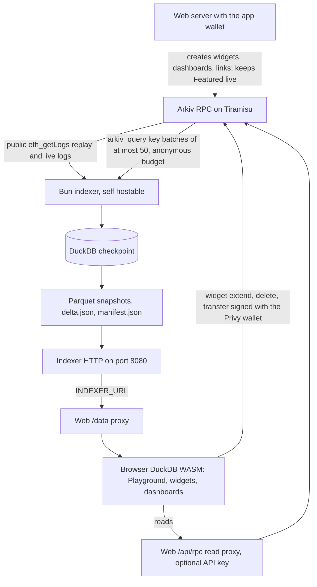

# Arkiv SQL Indexer

Plain SQL over every live Arkiv entity. The project has two parts:

1. **An open source, self hostable indexer** (`apps/indexer`). It mirrors all Arkiv entities on chain, or a subset chosen with `INDEX_EXPRESSION`, into versioned Parquet snapshots plus a JSON delta and a manifest served over HTTP. Run it with Docker Compose or Bun. MIT licensed.
2. **A web app** (`apps/web`) that runs against the hosted indexer covering all Arkiv data on Tiramisu. It offers a SQL Playground (DuckDB WASM in your browser), widgets (one SQL query plus a chart, saved as Arkiv entities) and public dashboards, including Featured dashboards kept live by the app.

Any app, script or AI agent can query the index with plain SQL instead of paging `arkiv_query` (200 results per page, no JOIN, GROUP BY or ORDER BY on attributes) and without hitting RPC rate limits. Expiry is honored everywhere: a row disappears the moment its expiry block passes. No API key is needed by default, and a `$creator` filter turns "who wrote this" into the trust boundary.

| | URL |
| :--- | :--- |
| Hosted app | https://arkiv-sql.dokploy.anshudhar.dev |
| Hosted indexer (all Tiramisu entities) | https://arkiv-sql-indexer.dokploy.anshudhar.dev |
| Demo video | `<VIDEO_URL>` |
| Entity schema and exact queries | [arkiv/schema.md](arkiv/schema.md) |
| Arkiv friction report | [arkiv/friction.md](arkiv/friction.md) |

Built during 9 to 18 October 2026 for Arkiv: Global Tour Stop on the Tiramisu testnet (chain ID 7738577) with `@arkiv-network/sdk` 0.8.1 and direct JSON RPC. Tracks: Open Source and Security. Licensed under the [MIT License](LICENSE).

## Architecture



| Path | Role |
| :--- | :--- |
| `packages/core` | Direct JSON RPC client, typed attribute decoding, `$key` chunk builder (SDK `eq`, `or`, `render`), browser merge views |
| `apps/indexer` | Log replay backfill, attribute filler, keyless live sync, Parquet snapshots, JSON delta, manifest, HTTP |
| `apps/web` | Next.js app: `/data` proxy, `/api/rpc` read proxy, DuckDB WASM loader, browser live tail, Playground, widgets, dashboards, Privy login |
| `arkiv` | Entity schema, exact queries and the friction report |

How data flows:

1. Backfill replays native operation logs from block zero over the public RPC without credentials and computes the live key set at a confirmed block (head minus 3).
2. Every live entity is written at once from log data (owner, creator, blocks, expiry, flags) with `attrs_pending = true`, and snapshot v1 is published.
3. A filler fetches attributes newest first with `arkiv_query` batches of at most 50 `$key` terms pinned to the indexed block, on the anonymous public budget. Each fill reaches browsers through the delta.
4. Live sync applies `EntityCreated`, `EntityPatched`, `ExpiryExtended`, `OwnershipTransferred` and `EntityDeleted` straight from public logs every 5 blocks. Patches mark rows pending again for the filler.
5. The browser imports the snapshot, polls the delta every 2 seconds, tails logs every 4 seconds, and reads `eth_blockNumber` as `live_head`. Public SQL views filter `expires_at > live_head`.

## Quick start

### Self host the indexer

Requires Docker, or Bun 1.3 (tested with 1.3.11), and outbound access to `https://rpc.tiramisu.db-chain.testnet.arkiv.network`. No API key is needed.

With Docker, indexer only:

```sh
git clone https://github.com/SlayerAnsh/hackathon-duckdb-indexer.git sql-indexer
cd sql-indexer
docker build -f apps/indexer/Dockerfile -t arkiv-sql-indexer .
docker run -d -p 8080:8080 -v "$PWD/data:/data" arkiv-sql-indexer
curl -s http://localhost:8080/health
```

With Bun:

```sh
bun install
DATA_DIR=./data bun apps/indexer/src/main.ts
```

Both index every live Tiramisu entity. To index a subset, set `INDEX_EXPRESSION` (for example `-e INDEX_EXPRESSION='$creator = addr(0x...)'` with Docker) before the first start. A changed expression needs a fresh data directory, because startup refuses a store built for a different expression. Restarts resume from the checkpoint. The indexer serves the files in [Data API](#data-api-for-apps-and-ai-agents) at its root (`/health`, `/manifest.json`, `/delta.json`, `/snap/v<N>/...`).

### Full stack with Docker Compose

Runs the indexer and the web app together:

```sh
cp .env.example .env
docker compose -f docker-compose.yml -f docker-compose.local.yml up -d --build
```

Open http://localhost:3000. The base `docker-compose.yml` publishes no host ports, so the local override publishes port 3000. The indexer stays internal on port 8080 and is reachable through the web proxy at http://localhost:3000/data/health. The index lives in the host directory `INDEX_DATA_PATH` (default `./data`), so it survives `docker compose down`.

### Run the app locally against the hosted indexer

No local index needed. The `/data` proxy forwards to `INDEXER_URL`:

```sh
bun install
INDEXER_URL=https://arkiv-sql-indexer.dokploy.anshudhar.dev bun run --cwd apps/web dev
```

Open http://localhost:3000. The Playground works with no secrets. Widgets and dashboards need your own Privy app and a funded app wallet (see [Web app environment](#web-app-environment)); they then show the entities created by your wallet, not the hosted app's. Next.js reads environment files from `apps/web`, so put local values in `apps/web/.env.local` (see [DEVELOPER.md](DEVELOPER.md)). Run the tests with `bun test`.

## Configuration

### Indexer environment

Defaults come from `apps/indexer/src/config.ts`. Compose passes the same names through `.env`.

| Variable | Default | Purpose |
| :--- | :--- | :--- |
| `INDEX_EXPRESSION` | blank | Arkiv query expression to index; blank indexes every entity. Keep single quotes in `.env` so Compose preserves `$creator` |
| `PUBLIC_RPC_URL` | Tiramisu public RPC | Log replay, live logs and chain metadata, never keyed |
| `BACKFILL_MODE` | `logs` | `logs` replays public logs; `query` opts into the legacy keyed expression scan |
| `FILL_RPC_URL` | Tiramisu public RPC | Attribute fills for pending rows |
| `FILL_USE_API_KEY` | `false` | Send the API key with fills |
| `SYNC_USE_API_KEY` | `false` | Keyed live sync on `ARKIV_RPC_URL` |
| `ARKIV_RPC_URL` | Tiramisu public RPC | Keyed RPC, used only by keyed modes |
| `TIRAMISU_API_KEY` | blank | Optional Arkiv API key, sent only by the three keyed opt ins |
| `FILL_CHUNK` | `50` | Keys per fill query, at most 50 |
| `FILL_INTERVAL_MS` | `4000` | Pause between fill queries |
| `SYNC_PAUSED` | `false` | Serve an existing store with no RPC calls |
| `CONFIRMATIONS` | `3` | Blocks behind head |
| `SYNC_BATCH_BLOCKS` | `5` | Blocks per live sync batch |
| `SNAPSHOT_INTERVAL_BLOCKS` | `30` | Blocks between snapshots |
| `KEEP_SNAPSHOTS` | `2` | Snapshot versions kept |
| `DATA_DIR` | `./data` (`/data` in Docker) | Store root |
| `PORT` | `8080` | HTTP port |
| `INDEX_DATA_PATH` | `./data` | Compose only: host path mounted at `/data` |

### Web app environment

| Variable | Scope | Purpose |
| :--- | :--- | :--- |
| `INDEXER_URL` | Web runtime | Upstream of the `/data` proxy. Compose sets `http://indexer:8080`; the hosted indexer is `https://arkiv-sql-indexer.dokploy.anshudhar.dev` |
| `DATA_DIR` | Web runtime, optional | Read only copy of the index served when the indexer is unreachable |
| `NEXT_PUBLIC_TIRAMISU_RPC_URL` | Web build and runtime | Public RPC for wallet signing, server writes and the upstream of `/api/rpc`; never include credentials |
| `NEXT_PUBLIC_EXPLORER_URL` | Web build and runtime | Block explorer for address links |
| `NEXT_PUBLIC_PRIVY_APP_ID` | Web build and runtime | Public Privy app ID; blank disables widgets and dashboards |
| `PRIVY_APP_SECRET` | Web runtime only | Privy verification and session signing |
| `DASHBOARD_PRIVATE_KEY` | Web runtime only | Funded Tiramisu app wallet that creates every widget, dashboard and link |
| `TIRAMISU_API_KEY` | Web runtime only (and indexer) | Optional. The web server adds it to browser reads proxied through `POST /api/rpc` and to server dashboard reads; without it reads use the anonymous budget. Never a build argument or `NEXT_PUBLIC_` variable |

`NEXT_PUBLIC_` values are embedded at build time, so rebuild after changing them. `GET /api/dash/config` returns `{ wallet: string | null }`, deriving the public app wallet address from the configured key at runtime. Enable Google, Discord, X and Telegram in the Privy dashboard and Ethereum embedded wallets for all users.

## Web app features

* **Playground** (`/playground`): SQL editor with schema aware autocomplete, snippets, history, CSV export, and Payload and Verify per row. Queries run in DuckDB WASM in your tab.
* **Widgets** (`/widgets/new`, `/widgets/<key>`): one SQL query plus a chart, saved as an Arkiv entity. The app wallet creates the widget (saving is free) and transfers it to your wallet in the same batch. You then extend, delete or transfer it by signing in the browser, which needs GLM on Tiramisu. Lifetimes are 1, 7, 30 or 90 days. Anyone logged in can extend a live widget. Editing saves a new version.
* **Dashboards** (`/d/<key>`, organize at `/d/<key>/edit`): public pages that arrange your own or anyone's widgets. Featured dashboards are owned by the app wallet and kept live automatically.
* **Explore** (`/explore`): public dashboards and widgets. **Home** (`/me`): your dashboards, widgets and activity. `/about` explains the architecture and expiry. The old showcase page and `/widgets` redirect to Explore.
* **Login** through Privy (Google, Discord, X or Telegram) with an embedded wallet. Browsing needs no login.

Everything is public, including SQL and dashboard content. The app writes the embedded wallet address and login provider on chain, never email addresses, social handles or Privy user IDs. Do not put personal information in widget SQL, names or dashboard content.

## Deployment

### Dokploy

1. Create a Docker Compose application from this repository with compose path `./docker-compose.dokploy.yml` and keep Isolated Deployments enabled. This file stores the index in the named Docker volume `index-data` (indexer read and write, web read only), so redeploys keep it even though Dokploy wipes the cloned code folder.
2. In the Environment tab set the web variables above. Leave `INDEX_EXPRESSION` blank to index everything, or set it single quoted.
3. In the Domains tab add the domain for service `web`, container port `3000`, with HTTPS. To publish the data API directly, as the hosted indexer does, also add a domain for service `indexer`, container port `8080`.
4. Deploy, then open `https://<domain>/data/health`.

Run one web instance: nonces, rate limits, the serial wallet queue and the Featured keepalive timer are in memory.

### Filtered index for your own app wallet

Production leaves `INDEX_EXPRESSION` blank. A self hosted filtered index can scope to the app wallet:

```dotenv
INDEX_EXPRESSION='$creator = addr(<dashboard wallet address>)'
```

Replace the placeholder with the lowercase address shown by `GET /api/dash/config`. If keeping other creator scopes, include the app wallet with `OR`. Changing the expression requires a fresh data directory and full backfill. Dashboard reads always filter on the app wallet's creator address and project, even when the expression is blank.

## Data API (for apps and AI agents)

The indexer serves these paths at its root, and the web app proxies them read only under `/data` (`apps/web/lib/proxy.ts`, `apps/indexer/src/http.ts`). Use the hosted indexer at https://arkiv-sql-indexer.dokploy.anshudhar.dev, the hosted app proxy at https://arkiv-sql.dokploy.anshudhar.dev/data, or your own. If the indexer is down and `DATA_DIR` is set, the proxy serves the same files from disk with the header `x-served-by: disk`. No other paths are proxied.

| Request | Returns |
| :--- | :--- |
| `GET /health` | `{"headBlock","headLag","lastSnapshot","live","pending"}` |
| `GET /manifest.json` | `chainId`, `genesisHash`, `expression`, `version`, `snapshotBlock`, `headBlock`, `files` (`entities`, `attributes`), `delta`, `live`, `pending` |
| `GET /delta.json` | `{"fromBlock","toBlock","entities":[...],"attributes":[...],"tombstones":[{"key","block"}]}` for every key changed after `snapshotBlock` |
| `GET` or `HEAD /snap/v<N>/entities.parquet` | Entity rows: `key`, `owner`, `creator`, `created_at`, `updated_at`, `expires_at`, `content_type`, `creation_flags`, `attrs_pending` |
| `GET` or `HEAD /snap/v<N>/attributes.parquet` | Attribute rows: `key`, `name`, `type`, `value`, `num` |

Manifest and delta use `Cache-Control: no-cache` with an ETag, so `If-None-Match` returns 304 when nothing changed. Parquet files are immutable (`public, max-age=300, immutable`) and support `Range` requests (206). Always read file paths from the manifest: the indexer publishes a new version about every 30 blocks and keeps only the latest two, so a 404 on a Parquet file means it was pruned and the manifest should be read again. Column meanings are in [arkiv/schema.md](arkiv/schema.md).

```sh
BASE=https://arkiv-sql-indexer.dokploy.anshudhar.dev   # or http://localhost:3000/data
curl -s $BASE/health
curl -s $BASE/manifest.json
```

Count snapshot rows with the DuckDB CLI (tested against the hosted indexer: 36,456 rows):

```sh
duckdb -c "INSTALL httpfs; LOAD httpfs; SET VARIABLE base = 'https://arkiv-sql-indexer.dokploy.anshudhar.dev/'; SET VARIABLE snap = (SELECT files.entities FROM read_json(getvariable('base') || 'manifest.json')); SELECT count(*) FROM read_parquet(getvariable('base') || getvariable('snap'));"
```

Join entities with attributes, here the most common attribute names:

```sql
INSTALL httpfs; LOAD httpfs;
SET VARIABLE base = 'https://arkiv-sql-indexer.dokploy.anshudhar.dev/';
SET VARIABLE m = (SELECT files FROM read_json(getvariable('base') || 'manifest.json'));
SELECT a.name, count(*) AS entities
FROM read_parquet(getvariable('base') || getvariable('m').entities) e
JOIN read_parquet(getvariable('base') || getvariable('m').attributes) a USING (key)
GROUP BY a.name ORDER BY entities DESC LIMIT 5;
```

For rows newer than the snapshot, apply the delta the way the browser does (`packages/core/src/views.ts`): a delta entity replaces the snapshot row and all its attributes for that key, a tombstone removes the key, and an entity is live while `expires_at` is above the current head. Rows with `attrs_pending = true` have no attribute rows yet. Run it in the same session as the join example. Against the hosted indexer this merge matched the `live` count in `/health`:

```sql
CREATE TABLE delta AS SELECT * FROM read_json(getvariable('base') || 'delta.json', columns = {
  toBlock: 'UBIGINT',
  entities: 'STRUCT(key VARCHAR, owner VARCHAR, creator VARCHAR, created_at UBIGINT, updated_at UBIGINT, expires_at UBIGINT, content_type VARCHAR, creation_flags INTEGER, attrs_pending BOOLEAN)[]',
  tombstones: 'STRUCT(key VARCHAR, block UBIGINT)[]'});
CREATE TABLE live AS
  SELECT * FROM read_parquet(getvariable('base') || getvariable('m').entities)
  WHERE key NOT IN (SELECT unnest(entities).key FROM delta)
    AND key NOT IN (SELECT unnest(tombstones).key FROM delta)
  UNION ALL BY NAME
  SELECT unnest(e) FROM (SELECT unnest(entities) AS e FROM delta);
SELECT count(*) AS live_entities FROM live WHERE expires_at > (SELECT toBlock FROM delta);
```

Python with the `duckdb` package (untested sketch, same SQL as above):

```python
import duckdb, json, urllib.request

base = "https://arkiv-sql-indexer.dokploy.anshudhar.dev/"
manifest = json.load(urllib.request.urlopen(base + "manifest.json"))
con = duckdb.connect()
con.execute("INSTALL httpfs; LOAD httpfs;")
print(con.sql(f"""
  SELECT a.name, count(*) AS entities
  FROM read_parquet('{base}{manifest['files']['entities']}') e
  JOIN read_parquet('{base}{manifest['files']['attributes']}') a USING (key)
  GROUP BY a.name ORDER BY entities DESC LIMIT 5
""").fetchall())
```

## Judge reproduction

1. Start the stack as in "Full stack with Docker Compose" and run `docker compose logs indexer`. The first line reads `API key not used: live sync applies public logs and attributes fill on the anonymous RPC budget.` Then it logs `Replayed logs through block N` per window and `Live keys at block N` when backfill is done.
2. Open http://localhost:3000/data/health. It returns `headBlock`, `headLag`, `lastSnapshot`, `live` and `pending`. `pending` falls as the filler fetches attributes newest first.
3. Open the hosted app and open a Featured dashboard from the landing page. Every chart is one DuckDB query in your tab, with its SQL available to inspect. In the browser network tab, Parquet loads from `/data/snap/v<n>/`, while `eth_blockNumber`, `eth_getLogs` and occasional `arkiv_query` calls go to the same origin read proxy `/api/rpc`. The browser never holds credentials.
4. Open `/playground` and run "Most placed widgets". It joins widget and link entities for `arkiv-sql-indexer-dash`, counts distinct dashboards, and includes widgets with zero placements. Links must share the widget creator.
5. Run `SELECT key, creator, owner, updated_at, expires_at FROM entities LIMIT 20` and click Payload or Verify on a row (or Verify page for all rows). Payload fetches the payload by `$key` from the RPC. Verify compares `updatedAt` and `expiresAt` from the RPC with the indexed row and the live head, and labels it `ok`, `stale`, `extended`, `expired` or `deleted`.
6. Watch expiry: `SELECT key, expires_at FROM entities ORDER BY expires_at LIMIT 5`, wait until the status bar's chain block passes one `expires_at`, and run it again. The row is gone without any event, because the public `entities` view filters against the live head read from RPC.
7. Optional: `bun install && bun test` runs every suite offline against fakes. `apps/indexer/test/keyless.test.ts` asserts that no default indexer request carries `Authorization` or `X-API-Key`.

## Security and trust

* **App wallet identity.** `GET /api/dash/config` shows the app wallet address derived from `DASHBOARD_PRIVATE_KEY`. This wallet is the Arkiv creator of every widget, dashboard and link, so application reads filter on `$creator` plus the project tag. Attributes alone are never an identity boundary, since anyone can write a `project` or `type` attribute. The indexer warns at startup when the expression has no `$creator` term.
* **Ownership.** User widgets are created `readonly` with permissionless extension and transferred to the user's wallet, so the user controls delete, transfer and new versions. Featured entities require both the `user` attribute and `$owner` to equal the app wallet; the server refuses app wallet sessions in user writes, so users cannot forge them.
* **No server SQL.** All SQL runs in the visitor's browser. Stored widget SQL passes a guard before running, capped at 5,000 result rows.
* **Secrets stay on the server.** `PRIVY_APP_SECRET`, `DASHBOARD_PRIVATE_KEY` and `TIRAMISU_API_KEY` live only in runtime environments, never build arguments or `NEXT_PUBLIC_` variables. `test/deployment.test.ts` enforces this.
* **Read proxy.** `POST /api/rpc` forwards only read methods (`arkiv_query`, `eth_blockNumber`, `eth_chainId`, `eth_getBlockByNumber`, `eth_getLogs`, `eth_getBalance`), caps the body at 64 KB and batches at 20 calls, rate limits per client IP and times out after 15 seconds. Wallet signing uses the public RPC directly.
* **Server writes.** `/api/dash` routes need a verified Privy token plus a signed single use nonce, and run through one serial wallet queue with per address and global rate limits.

## Expiry

Three layers enforce expiry. Snapshots exclude entities whose `expires_at <= head` at build time. The indexer sweeps expired rows every batch and removes snapshots older than `KEEP_SNAPSHOTS` versions (default two). The browser filters merged entities against `live_head` read from Arkiv RPC and joins attributes only to those live entities. Existing snapshot bytes can retain a row until that snapshot is pruned, but SQL views hide it at expiry. A consumer can copy data while it is live, so this is not a promise to erase third party copies.

## Indexer RPC usage

By default the indexer never sends the API key, and startup logs `API key not used`. Backfill and live sync read only public `eth_getLogs` and block headers. The filler fetches attributes for pending keys with `$key` batches on the anonymous budget, and a 429 pauses only the filler until Retry-After. On Tiramisu about 2,800 distinct keys change per hour, so keyed live sync would spend roughly 25 to 35 percent of the monthly quota per day.

Three explicit settings send `TIRAMISU_API_KEY`. Each one fails at startup without the key and logs a warning: `SYNC_USE_API_KEY=true` (keyed live sync on `ARKIV_RPC_URL`), `FILL_USE_API_KEY=true` (fills with the key) and `BACKFILL_MODE=query` (legacy paginated expression scan plus keyed live sync). With a filter expression that has no `$creator` or `$owner` term, keyless sync cannot see an existing entity that starts matching through a patch; use `SYNC_USE_API_KEY=true` for that case. Set `SYNC_PAUSED=true` to serve an existing store with no RPC calls at all.

## Roadmap

Future work includes Parquet expiry buckets, DataFusion, DuckLake and server side SQL. These are outside the current browser SQL design.

## License

MIT. See [LICENSE](LICENSE). Copyright (c) 2026 Anshudhar.
