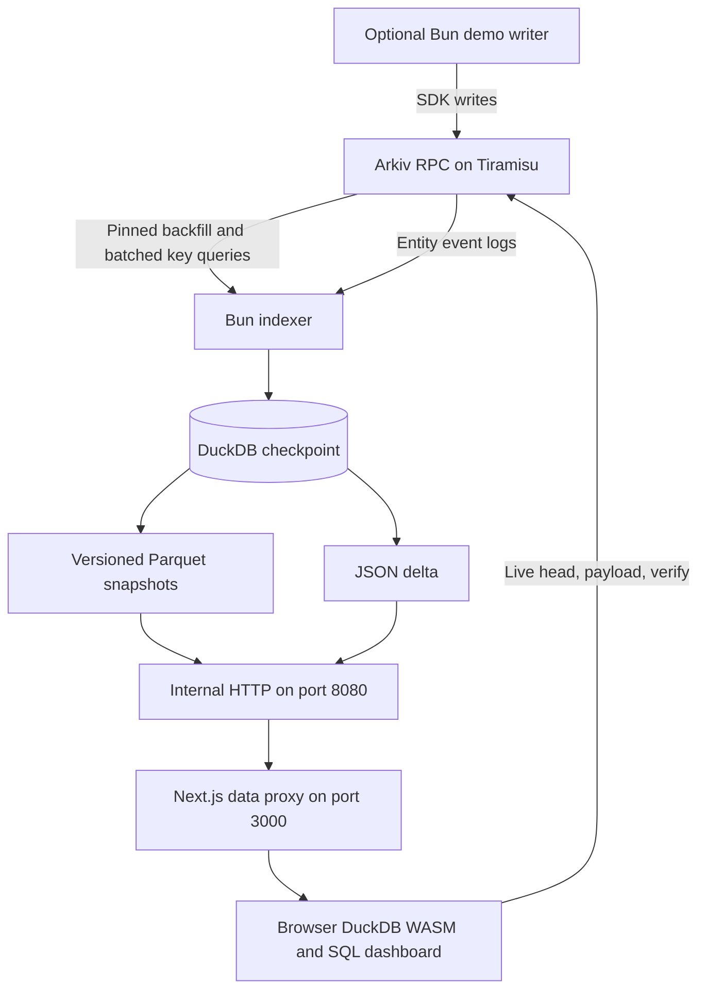

# Arkiv SQL Indexer

Run SQL over live Arkiv data in your browser. A Bun indexer mirrors one selective Arkiv expression into Parquet snapshots and a JSON delta, while a Next.js dashboard loads the data into DuckDB WASM for joins, grouping, and exploration without a server SQL endpoint. The synthetic support desk demonstrates updates, ownership transfers, and expiring data.

Live demo: TODO

Built during 9 to 18 October 2026. Tracks: Open Source and Security. Licensed under [MIT](LICENSE).

## Quick start

Requires Docker with Compose v2, access to Tiramisu, and a Tiramisu API key.

```sh
cp .env.example .env
```

Fill `TIRAMISU_API_KEY` and set `INDEX_EXPRESSION` in `.env` to this exact demo expression. Keep the single quotes so Compose preserves the dollar sign:

```dotenv
INDEX_EXPRESSION='$creator = addr(0x1f61c3cac1612c020f64739b128c5f198939c8cd)'
```

```sh
docker compose up -d --build
```

Open http://localhost:3000 after the initial backfill and indexer health check complete. Only port 3000 is published. TLS and a public domain belong in the host proxy in front of that port.

For synthetic writes, also fill `DEMO_PRIVATE_KEY` with the funded demo wallet's testnet signing key and `DEMO_AGENT_ADDRESSES` with the two comma separated agent addresses below, then run:

```sh
docker compose --profile demo up -d --build
```

The writer is disabled without the demo profile. No private key is committed. `TIRAMISU_API_KEY` is used only by the indexer, never by the web image or browser. Payload and verify requests go directly to the visitor's public RPC and spend the visitor's anonymous query budget. `NEXT_PUBLIC_TIRAMISU_RPC_URL` is public and embedded at web build time, so rebuild after changing it. Never put credentials in this URL.

The named `index-data` volume retains the DuckDB checkpoint and snapshots across `docker compose down` and subsequent startup. Do not use `down -v` if you want to retain data. A changed index expression requires a separate or deliberately cleared store; startup refuses to reuse a store with a different expression.

## Demo identities

| Role | Address |
| :--- | :--- |
| Demo wallet | `0x1f61c3cac1612C020f64739B128C5f198939C8Cd` |
| Agent one | `0xb0B87EdDB0bc777Eb663c7a11703ba5ED4849A28` |
| Agent two | `0xF1BC753cF42d0157Ac34E28DBf06108F66aDB3B3` |

The `$creator` filter keeps tickets indexed after their owner changes to an agent. User attributes alone are not an identity boundary because anyone can write them. This creator boundary and browser execution of SQL form the Security track story.

## Architecture



This follows SPECS §6 with batched live sync and no browser live tail. The browser polls the delta and chain head. See [schema and queries](arkiv/schema.md), [provider friction](arkiv/friction.md), and [developer guide](DEVELOPER.md).

## Expiry

Three layers enforce expiry. Snapshots exclude entities whose `expires_at <= head` at build time. The indexer sweeps expired rows and removes snapshots older than `KEEP_SNAPSHOTS` versions, default two. The browser filters merged entities against `live_head` read directly from Arkiv RPC and joins attributes only to those live entities. Existing snapshot bytes can retain a row until that snapshot is pruned; SQL views hide it at expiry. A consumer can copy data while it is live, so this is not a promise to erase third party copies.

## Submission and roadmap

Demo video: TODO. Record less than 3 minutes showing the dashboard, a JOIN and GROUP BY, heartbeat expiry, verify, and the `$creator` filter badge. Heartbeats live for 10 minutes, so prepare one near expiry before recording.

Future work includes Parquet expiry buckets, DataFusion, DuckLake, and server side SQL. These are outside the current browser SQL design.
