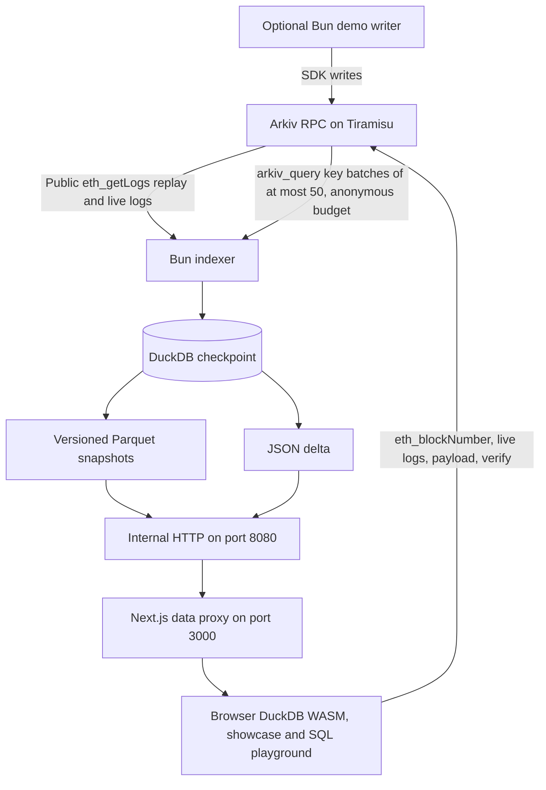

# Arkiv SQL Indexer

Open source analytics for Arkiv, aimed at developers. A Bun indexer mirrors Arkiv into versioned Parquet snapshots plus a JSON delta, so any app, script or AI agent can query every live entity in milliseconds with plain SQL, without paging `arkiv_query` (200 results per page, no JOIN, GROUP BY or ORDER BY on attributes) and without hitting RPC rate limits. One `docker compose up` gives you your own read only Arkiv data API over HTTP, and a Next.js app runs full SQL over the same files in DuckDB WASM in the visitor's tab. Expiry is honored everywhere: a row disappears the moment its expiry block passes. No API key is needed by default, and a `$creator` filter turns "who wrote this" into the trust boundary. A synthetic support desk writer shows batch creates, patches, lease style extensions, ownership transfers and expiring data.

* Live app: https://arkiv-sql.dokploy.anshudhar.dev
* Demo video: `<VIDEO_URL>`
* Entity schema and exact queries: [arkiv/schema.md](arkiv/schema.md)
* Arkiv friction report: [arkiv/friction.md](arkiv/friction.md)

Built during 9 to 18 October 2026 for Arkiv: Global Tour Stop on the Tiramisu testnet (chain ID 7738577) with `@arkiv-network/sdk` 0.8.1 and direct JSON RPC. Tracks: Open Source and Security. Licensed under the [MIT License](LICENSE).

## Architecture



| Path | Role |
| :--- | :--- |
| `packages/core` | Direct JSON RPC client, typed attribute decoding, `$key` chunk builder (SDK `eq`, `or`, `render`), browser merge views |
| `apps/indexer` | Log replay backfill, attribute filler, keyless live sync, Parquet snapshots, JSON delta, internal HTTP |
| `apps/web` | Next.js data proxy, DuckDB WASM loader, browser live tail, showcase charts, SQL playground, payload and verify actions |
| `apps/demo-writer` | Synthetic support desk that writes through the SDK wallet client |

How data flows:

1. Backfill replays native operation logs from block zero over the public RPC without credentials and computes the live key set at a confirmed block (head minus 3).
2. Every live entity is written at once from log data (owner, creator, blocks, expiry, flags) with `attrs_pending = true`, and snapshot v1 is published.
3. A filler fetches attributes newest first with `arkiv_query` batches of at most 50 `$key` terms pinned to the indexed block, on the anonymous public budget. Each fill reaches browsers through the delta.
4. Live sync applies `EntityCreated`, `EntityPatched`, `ExpiryExtended`, `OwnershipTransferred` and `EntityDeleted` straight from public logs every 5 blocks. Patches mark rows pending again for the filler.
5. The browser imports the snapshot, polls the delta every 2 seconds, tails logs from the public RPC every 4 seconds, and reads `eth_blockNumber` as `live_head`. Public SQL views filter `expires_at > live_head`.

The web app has four pages: `/` (story and live stats), `/showcase` (chart cards, each one SQL query with the clause `arkiv_query` cannot express), `/playground` (SQL editor with schema aware autocomplete, history, CSV export, Payload and Verify per row) and `/about`.

## Run locally with Docker Compose

Requires Docker with Compose v2 and outbound access to `https://rpc.tiramisu.db-chain.testnet.arkiv.network`. No API key is needed.

```sh
git clone <this repository>
cd sql-indexer
cp .env.example .env
docker compose -f docker-compose.yml -f docker-compose.local.yml up -d --build
```

Open http://localhost:3000. The base `docker-compose.yml` publishes no host ports, so the local override is what publishes port 3000. The indexer stays internal on port 8080 and is reachable through the web proxy at http://localhost:3000/data/health.

Leave `INDEX_EXPRESSION` blank to index every live Tiramisu entity, or scope the index to the demo wallet. Keep the single quotes so Compose preserves the dollar sign:

```dotenv
INDEX_EXPRESSION='$creator = addr(0x1f61c3cac1612c020f64739b128c5f198939c8cd)'
```

A changed expression needs a fresh data directory, because startup refuses to reuse a store built for a different expression. The index lives in the host directory `INDEX_DATA_PATH` (default `./data`), so it survives `docker compose down` and restarts resume from the checkpoint.

### Run without Docker

Requires Bun 1.3 (tested with 1.3.11).

```sh
bun install
DATA_DIR=./data bun apps/indexer/src/main.ts
INDEXER_URL=http://localhost:8080 bun run --cwd apps/web dev
```

The indexer reads the same variables as `.env.example`; Bun loads `.env` from the working directory automatically. Run the tests with `bun test` (see [DEVELOPER.md](DEVELOPER.md)).

### Optional demo writer

The writer is off unless the `demo` profile is enabled. It needs a funded Tiramisu testnet key of your own in `DEMO_PRIVATE_KEY` and the two agent addresses in `DEMO_AGENT_ADDRESSES` (comma separated):

```sh
docker compose -f docker-compose.yml -f docker-compose.local.yml --profile demo up -d --build
```

Setting `COMPOSE_PROFILES=demo` in `.env` has the same effect. No private key is committed. The writer never sees `TIRAMISU_API_KEY`.

### Deploy with Dokploy

1. Create a Docker Compose application from this repository with compose path `./docker-compose.yml` and keep Isolated Deployments enabled.
2. In the Environment tab set `INDEX_EXPRESSION` (single quoted, as above) and `INDEX_DATA_PATH=../files/data` so the index survives redeploys. For the writer also set `DEMO_PRIVATE_KEY`, `DEMO_AGENT_ADDRESSES` and `COMPOSE_PROFILES=demo`.
3. In the Domains tab add the domain for service `web`, container port `3000`, with HTTPS. The indexer stays internal.
4. Deploy, then open `https://<domain>/data/health`.

## Data API (for apps and AI agents)

The web proxy exposes the index read only at `http://localhost:3000/data` (hosted: https://arkiv-sql.dokploy.anshudhar.dev/data). It forwards to the internal indexer (`apps/web/lib/proxy.ts`, `apps/indexer/src/http.ts`). If the indexer is down, it serves the same files from its read only mount of the data directory (`DATA_DIR`, `apps/web/lib/disk-data.ts`) and adds the header `x-served-by: disk`. No other paths are proxied.

| Request | Returns |
| :--- | :--- |
| `GET /data/health` | `{"headBlock","headLag","lastSnapshot","live","pending"}` |
| `GET /data/manifest.json` | `chainId`, `genesisHash`, `expression`, `version`, `snapshotBlock`, `headBlock`, `files` (`entities`, `attributes`), `delta`, `live`, `pending` |
| `GET /data/delta.json` | `{"fromBlock","toBlock","entities":[...],"attributes":[...],"tombstones":[{"key","block"}]}` for every key changed after `snapshotBlock` |
| `GET` or `HEAD /data/snap/v<N>/entities.parquet` | Entity rows: `key`, `owner`, `creator`, `created_at`, `updated_at`, `expires_at`, `content_type`, `creation_flags`, `attrs_pending` |
| `GET` or `HEAD /data/snap/v<N>/attributes.parquet` | Attribute rows: `key`, `name`, `type`, `value`, `num` |

Manifest and delta use `Cache-Control: no-cache` with an ETag, so `If-None-Match` returns 304 when nothing changed. Parquet files are immutable (`public, max-age=300, immutable`) and support `Range` requests (206). Always read file paths from the manifest: the indexer publishes a new version about every 30 blocks and keeps only the latest two. Column meanings are in [arkiv/schema.md](arkiv/schema.md).

```sh
curl -s http://localhost:3000/data/health
curl -s http://localhost:3000/data/manifest.json
curl -s -H 'Range: bytes=0-99' -o /dev/null -w '%{http_code}\n' http://localhost:3000/data/snap/v1/entities.parquet
```

Replace `v1` with the version in `files.entities`. Count snapshot rows with the DuckDB CLI (tested: 34,616 rows in 1.4 s):

```sh
duckdb -c "INSTALL httpfs; LOAD httpfs; SET VARIABLE snap = (SELECT files.entities FROM read_json('http://localhost:3000/data/manifest.json')); SELECT count(*) FROM read_parquet('http://localhost:3000/data/' || getvariable('snap'));"
```

Join entities with attributes, here the most common attribute names (tested):

```sql
INSTALL httpfs; LOAD httpfs;
SET VARIABLE base = 'http://localhost:3000/data/';
SET VARIABLE m = (SELECT files FROM read_json('http://localhost:3000/data/manifest.json'));
SELECT a.name, count(*) AS entities
FROM read_parquet(getvariable('base') || getvariable('m').entities) e
JOIN read_parquet(getvariable('base') || getvariable('m').attributes) a USING (key)
GROUP BY a.name ORDER BY entities DESC LIMIT 5;
```

For rows newer than the snapshot, apply the delta the way the browser does (`packages/core/src/views.ts`): a delta entity replaces the snapshot row and all its attributes for that key, a tombstone removes the key, and an entity is live while `expires_at` is above the current head. Rows with `attrs_pending = true` have no attribute rows yet. Run it in the same session as the join example. This merge was tested and matched the `live` count in `/data/health`:

```sql
CREATE TABLE delta AS SELECT * FROM read_json('http://localhost:3000/data/delta.json', columns = {
  toBlock: 'UBIGINT',
  entities: 'STRUCT(key VARCHAR, owner VARCHAR, creator VARCHAR, created_at UBIGINT, updated_at UBIGINT, expires_at UBIGINT, content_type VARCHAR, creation_flags INTEGER, attrs_pending BOOLEAN)[]',
  tombstones: 'STRUCT(key VARCHAR, block UBIGINT)[]'});
CREATE TABLE live AS
  SELECT * FROM read_parquet(getvariable('base') || getvariable('m').entities)
  WHERE key NOT IN (SELECT unnest(entities).key FROM delta)
    AND key NOT IN (SELECT unnest(tombstones).key FROM delta)
  UNION ALL BY NAME
  SELECT unnest(e) FROM (SELECT unnest(entities) AS e FROM delta);
SELECT count(*) AS live_entities FROM live WHERE expires_at > (SELECT toBlock FROM delta);
```

Python with the `duckdb` package (untested sketch, same SQL as above):

```python
import duckdb, json, urllib.request

base = "http://localhost:3000/data/"
manifest = json.load(urllib.request.urlopen(base + "manifest.json"))
con = duckdb.connect()
con.execute("INSTALL httpfs; LOAD httpfs;")
print(con.sql(f"""
  SELECT a.name, count(*) AS entities
  FROM read_parquet('{base}{manifest['files']['entities']}') e
  JOIN read_parquet('{base}{manifest['files']['attributes']}') a USING (key)
  GROUP BY a.name ORDER BY entities DESC LIMIT 5
""").fetchall())
```

To serve only a subset, set `INDEX_EXPRESSION` in `.env` before the first start (for example the `$creator` expression above) and run `docker compose -f docker-compose.yml -f docker-compose.local.yml up -d`.

## Judge reproduction

1. Start the stack as in "Run locally with Docker Compose" and run `docker compose logs indexer`. The first line reads `API key not used: live sync applies public logs and attributes fill on the anonymous RPC budget.` Then it logs `Replayed logs through block N` per window and `Live keys at block N` when backfill is done.
2. Open http://localhost:3000/data/health. It returns `headBlock`, `headLag`, `lastSnapshot`, `live` and `pending`. `pending` falls as the filler fetches attributes newest first.
3. Open http://localhost:3000/showcase. Each card is one DuckDB query in your tab and names the clause `arkiv_query` cannot express (GROUP BY, JOIN, window function, ORDER BY on attributes). Open the browser network tab: Parquet loads from `/data/snap/v<n>/`, while `eth_blockNumber`, `eth_getLogs` and occasional `arkiv_query` calls go straight to the public Tiramisu RPC with no credentials.
4. Open http://localhost:3000/playground and run the featured query "Open tickets with most discussion". It JOINs tickets to their comments and groups by ticket. With a blank expression it covers every live entity whose `type` attribute is `ticket`, from any creator; with the demo `$creator` expression it covers only the demo wallet's data.
5. Run `SELECT key, creator, owner, updated_at, expires_at FROM entities LIMIT 20` and click Payload or Verify on a row (or Verify page for all rows). Payload fetches the payload by `$key` from the RPC. Verify compares `updatedAt` and `expiresAt` from the RPC with the indexed row and the live head, and labels it `ok`, `stale`, `extended`, `expired` or `deleted`.
6. Watch expiry: `SELECT key, expires_at FROM entities ORDER BY expires_at LIMIT 5`, wait until the status bar's chain block passes one `expires_at`, and run it again. The row is gone without any event, because the public `entities` view filters against the live head read from RPC.
7. Optional: `bun install && bun test` runs every suite offline against fakes. `apps/indexer/test/keyless.test.ts` asserts that no default request carries `Authorization` or `X-API-Key`.

## Demo identities

| Role | Address |
| :--- | :--- |
| Demo wallet (creates every demo entity) | `0x1f61c3cac1612C020f64739B128C5f198939C8Cd` |
| Agent one (receives transferred tickets) | `0xb0B87EdDB0bc777Eb663c7a11703ba5ED4849A28` |
| Agent two (receives transferred tickets) | `0xF1BC753cF42d0157Ac34E28DBf06108F66aDB3B3` |

The `$creator` filter keeps a ticket indexed after its owner changes to an agent, because `$creator` never changes. User attributes alone are not an identity boundary, since anyone can write a `project` or `type` attribute. Startup warns when the expression has no `$creator` term. This creator boundary, plus running all SQL in the visitor's browser with no server SQL endpoint and no credentials in the browser, is the Security track story.

## Expiry

Three layers enforce expiry. Snapshots exclude entities whose `expires_at <= head` at build time. The indexer sweeps expired rows every batch and removes snapshots older than `KEEP_SNAPSHOTS` versions (default two). The browser filters merged entities against `live_head` read directly from Arkiv RPC and joins attributes only to those live entities. Existing snapshot bytes can retain a row until that snapshot is pruned, but SQL views hide it at expiry. A consumer can copy data while it is live, so this is not a promise to erase third party copies.

## Indexer RPC usage

By default the indexer never sends the API key, and startup logs `API key not used`. Backfill and live sync read only public `eth_getLogs` and block headers. The filler fetches attributes for pending keys with `$key` batches on the anonymous budget, and a 429 pauses only the filler until Retry-After. On Tiramisu about 2,800 distinct keys change per hour, so keyed live sync would spend roughly 25 to 35 percent of the monthly quota per day.

Three explicit settings send `TIRAMISU_API_KEY`. Each one fails at startup without the key and logs a warning: `SYNC_USE_API_KEY=true` (keyed live sync on `ARKIV_RPC_URL`), `FILL_USE_API_KEY=true` (fills with the key) and `BACKFILL_MODE=query` (legacy paginated expression scan plus keyed live sync). With a filter expression that has no `$creator` or `$owner` term, keyless sync cannot see an existing entity that starts matching through a patch; use `SYNC_USE_API_KEY=true` for that case.

Set `SYNC_PAUSED=true` to serve an existing store with no RPC calls at all. If the indexer is down, the web proxy serves the stored files from its read only mount of the same data directory. `NEXT_PUBLIC_TIRAMISU_RPC_URL` is embedded at web build time, so rebuild after changing it and never put credentials in it.

## Roadmap

Future work includes saved queries stored as Arkiv entities, Parquet expiry buckets, DataFusion, DuckLake and server side SQL. These are outside the current browser SQL design.

## License

MIT. See [LICENSE](LICENSE). Copyright (c) 2026 Anshudhar.
