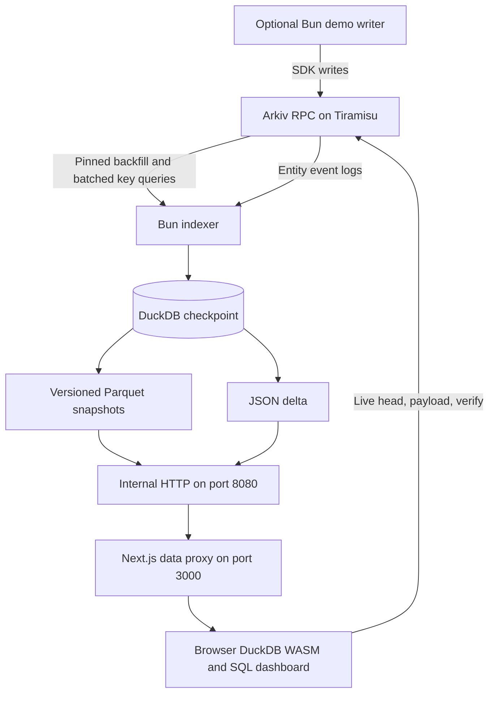

# Arkiv SQL Indexer

Run SQL over live Arkiv data in your browser. A Bun indexer mirrors every live Arkiv entity, optionally filtered by an Arkiv expression into Parquet snapshots and a JSON delta, while a Next.js dashboard loads the data into DuckDB WASM for joins, grouping, and exploration without a server SQL endpoint. The synthetic support desk demonstrates updates, ownership transfers, and expiring data.

Live demo: TODO

Built during 9 to 18 October 2026. Tracks: Open Source and Security. Licensed under [MIT](LICENSE).

## Quick start

Requires Docker with Compose v2, access to Tiramisu, and a Tiramisu API key.

```sh
cp .env.example .env
```

Fill `TIRAMISU_API_KEY` in `.env`. Leave `INDEX_EXPRESSION` blank to index every entity, or set it to this demo expression. Keep the single quotes so Compose preserves the dollar sign:

```dotenv
INDEX_EXPRESSION='$creator = addr(0x1f61c3cac1612c020f64739b128c5f198939c8cd)'
```

```sh
docker compose -f docker-compose.yml -f docker-compose.local.yml up -d --build
```

Open http://localhost:3000 after the initial backfill and indexer health check complete. The base `docker-compose.yml` publishes no host ports; the local override publishes port 3000.

### Deploy with Dokploy

1. Create a Docker Compose application from this repository, compose path `./docker-compose.yml`, and keep Isolated Deployments enabled.
2. In the Environment tab set `TIRAMISU_API_KEY`, `INDEX_EXPRESSION` (single quoted, as above), and for the demo writer `DEMO_PRIVATE_KEY`, `DEMO_AGENT_ADDRESSES` and `COMPOSE_PROFILES=demo`, plus `INDEX_DATA_PATH=../files/data` so the index survives redeploys (Dokploy keeps `../files` between deployments). Dokploy writes these to the `.env` file next to the compose file, and the compose file reads them with `${VAR}` references.
3. In the Domains tab add your domain for service `web`, container port `3000`, with HTTPS. Dokploy adds the Traefik labels at deploy time. The indexer stays internal.
4. Deploy, then open `https://<domain>/data/health` to check the indexer.

For synthetic writes, also fill `DEMO_PRIVATE_KEY` with the funded demo wallet's testnet signing key and `DEMO_AGENT_ADDRESSES` with the two comma separated agent addresses below, then run:

```sh
docker compose --profile demo up -d --build
```

The writer is disabled without the demo profile. No private key is committed. `TIRAMISU_API_KEY` is used only by the indexer, never by the web image or browser. Payload and verify requests go directly to the visitor's public RPC and spend the visitor's anonymous query budget. `NEXT_PUBLIC_TIRAMISU_RPC_URL` is public and embedded at web build time, so rebuild after changing it. Never put credentials in this URL.

The named `index-data` volume retains the DuckDB checkpoint and snapshots across `docker compose down` and subsequent startup. Do not use `down -v` if you want to retain data. A changed index expression requires a separate or deliberately cleared store; startup refuses to reuse a store with a different expression.

## Demo identities

| Role | Address |
| :--- | :--- |
| Demo wallet | `0x1f61c3cac1612C020f64739B128C5f198939C8Cd` |
| Agent one | `0xb0B87EdDB0bc777Eb663c7a11703ba5ED4849A28` |
| Agent two | `0xF1BC753cF42d0157Ac34E28DBf06108F66aDB3B3` |

The `$creator` filter keeps tickets indexed after their owner changes to an agent. User attributes alone are not an identity boundary because anyone can write them. This creator boundary and browser execution of SQL form the Security track story.

## Architecture



Freshness comes from a browser live tail on the public RPC endpoint without an API key. Logs update local rows, while creations and patches fetch attributes in batches of 50 at most once every 20 seconds. On anonymous budget exhaustion, attribute fetches wait until Retry-After while log updates continue. The status bar shows the live block, pending keys and budget state.

Set `SYNC_PAUSED=true` to serve an existing snapshot and delta without any backend RPC calls. An existing indexed store is required; an empty data directory causes startup to fail clearly. The API key is required only for active backend sync and never reaches the browser. See [schema and queries](arkiv/schema.md), [provider friction](arkiv/friction.md), and [developer guide](DEVELOPER.md).

## Expiry

Three layers enforce expiry. Snapshots exclude entities whose `expires_at <= head` at build time. The indexer sweeps expired rows and removes snapshots older than `KEEP_SNAPSHOTS` versions, default two. The browser filters merged entities against `live_head` read directly from Arkiv RPC and joins attributes only to those live entities. Existing snapshot bytes can retain a row until that snapshot is pruned; SQL views hide it at expiry. A consumer can copy data while it is live, so this is not a promise to erase third party copies.

## Submission and roadmap

Demo video: TODO. Record less than 3 minutes showing the dashboard, a JOIN and GROUP BY, heartbeat expiry, verify, and the `$creator` filter badge. Heartbeats live for 10 minutes, so prepare one near expiry before recording.

Future work includes Parquet expiry buckets, DataFusion, DuckLake, and server side SQL. These are outside the current browser SQL design.

Backfill defaults to `BACKFILL_MODE=logs`. It replays native operation logs from `PUBLIC_RPC_URL` without credentials, computes live keys at the confirmed block, then fetches rows in batches of 50 keys at that block. The backend API key is used only for key lookups in logs mode. Live sync uses the same public log and private key lookup split. `BACKFILL_MODE=query` explicitly opts into the legacy filtered query scan, which can consume substantial monthly quota.
